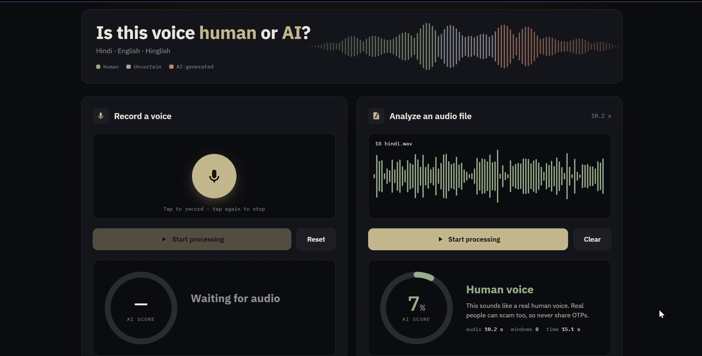
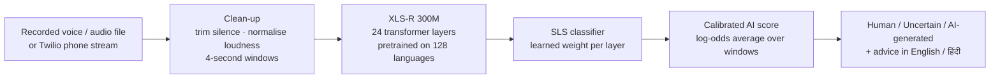
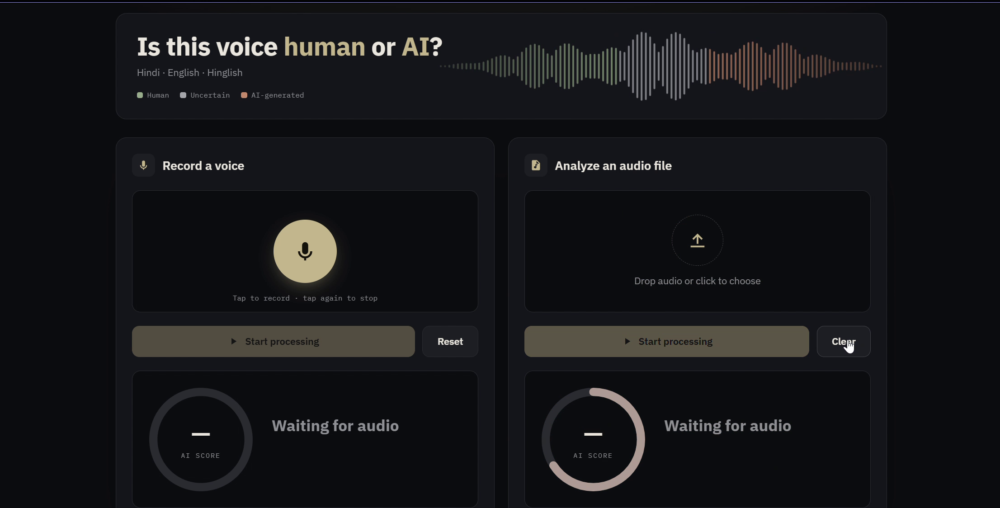

# Voice Shield

**AI voice-clone detection for phone scams, in Hindi, English and Hinglish.**
HYPNEXIS'26 · Track 01 AI & Machine Learning · Problem AI-01: *Voice-Clone Detection for Phone Scams*

Scammers clone the voice of a relative or a bank officer from a few seconds of audio. Voice Shield decides whether a
2–10 second clip is a real human voice or AI-generated, and is built to keep working on voice generators it never
saw during training.

[](docs/demo.mp4)

**[▶ Watch the demo video](docs/demo.mp4)** (68 s, no sound) · **[Full results](docs/RESULTS.md)**

---

## Results at a glance

| | Before fine-tuning | **After** |
|---|---|---|
| English test error (EER, clean / phone) | 20.5% / 24.8% | **11.8% / 12.3%** |
| Hindi test error (EER, clean / phone) | 25.6% / 28.6% | **15.6% / 12.4%** |
| Hindi AI tools **never seen in training** | 15.8% / 24.0% | **2.5% / 2.5%** |
| English AI tools **never seen in training** | 33.5% / 42.0% | **23.0% / 20.3%** |
| Our own recordings, unseen people | 61.1% / 72.2% | **5.6% / 5.6%** |
| Real human voices wrongly called AI | 29–100% | **0–2.2%** |

- In the app, on 46 unseen clips: **28 / 28 AI voices caught**, including Google TTS and Microsoft Edge neural voices,
  and **0 real voices called AI**.
- Against 4 public HuggingFace deepfake detectors on the same 80 clips, Voice Shield had the **lowest error
  (10.8% EER)** and flagged **0 of 60** real humans. Two public models flagged all 60.

Details and every number: [docs/RESULTS.md](docs/RESULTS.md).

---

## How it works



- **Model:** XLS-R 300M + SLS (Zhang et al., ACM Multimedia 2024), ~339M parameters, rebuilt on HuggingFace
  Transformers (the original needs fairseq) with a converter for the original weights.
- **Server:** FastAPI. Upload endpoint plus a WebSocket that accepts audio in **Twilio Media Streams** format
  (8 kHz μ-law), so it can sit behind a real phone line.
- **App:** record a voice or upload a file; the waveform is coloured by which seconds sound AI.



---

## Training (fine-tuning)

| | |
|---|---|
| Start | Public XLS-R + SLS checkpoint, trained on English ASVspoof 2019 only |
| Data | 35,576 training clips (67,277 collected) from 9 datasets + 120 of our own recordings |
| AI voices | ~150 generators: ASVspoof 2019, IndicSynth (FreeVC, XTTS-v2), MLAAD (143 English + 9 Hindi tools incl. ElevenLabs, MiniMax, F5-TTS, XTTS, Chatterbox, VibeVoice, Qwen3-TTS) |
| Real voices | ASVspoof 2019, FLEURS (Hindi + English), LibriSpeech, Svarah (Indian-accented English), Kathbath (Hindi), our recordings |
| Balance | Every batch 25% English-real, 25% English-AI, 25% Hindi-real, 25% Hindi-AI; equal share per AI tool |
| Augmentation | Random volume, noise, room echo, mic clipping; phone line (8 kHz + G.711 μ-law) on 50% of clips; silence trimmed |
| Optimiser | AdamW; LR 2e-6 transformer, 5e-5 classifier; CNN front-end frozen; fp16; 3,000 steps × 16 clips |
| Hardware | Free Kaggle T4 GPU, ~50 minutes |
| Selection | Best checkpoint on dev speakers never seen in training (12.98% dev EER) |
| Splits | Train / dev / test by speaker; 10 newest AI tools held out completely |

The whole pipeline is one self-contained notebook: [training/02_finetune_hindi_phone.ipynb](training/02_finetune_hindi_phone.ipynb).

## What is new in our approach

1. One model for **Hindi, English and Hinglish**, including **Indian-accented English** (Svarah).
2. **Equal training share per AI generator** across ~150 tools, so no tool dominates.
3. For every kind of AI voice, the **matching kind of real voice** (language, accent, reading style), so the model
   learns human vs AI rather than style.
4. **Phone-network training** (8 kHz, G.711 μ-law) and a **Twilio-format** streaming server.
5. **10 newest commercial tools held out** to measure generalization honestly.
6. Found and removed two hidden shortcuts: **loudness** (quiet audio called AI) and **audio-splicing clicks**.
7. **Calibrated scores** and **log-odds averaging** so a few weak seconds cannot hide an AI voice.
8. A real voice never shows "safe": the message still warns that real people can scam too.

---

## Run it locally

```powershell
cd voice-shield
py -3.14 -m venv .venv
.venv\Scripts\python -m pip install torch torchaudio --index-url https://download.pytorch.org/whl/cpu
.venv\Scripts\python -m pip install -r requirements.txt
.venv\Scripts\python -m uvicorn server.app:app --port 8001
```

Open http://localhost:8001.

**Model weights.** The fine-tuned model (`voice_shield_ft.pth`, ~650 MB) is too large for GitHub. Put it in `models/`.
To reproduce it, run the Kaggle notebook above. Without it, the app downloads the public starting checkpoint
`sukhdeveyash/XLS-R-SLS-Deepfake-Detection` (MIT) automatically. The cut-off for a model is set with
`python tools/set_threshold.py 0.03`.

## Repository

| Folder | Contents |
|---|---|
| `vs/` | Model rebuild, audio clean-up, phone simulation, augmentation, training loop, datasets, scoring |
| `server/` | FastAPI server: file scoring and Twilio-format WebSocket |
| `web/` | Dashboard |
| `training/` | Kaggle notebooks (baseline check, fine-tuning) |
| `tools/` | Scoring a test set, calibration, model comparison, notebook builder |
| `docs/` | Results, demo video, screenshots |

## Limitations

- AI audio **played from a speaker into a microphone** (replay) is not detected yet; that needs replay training data.
- Newest English generators remain the hardest case (~20% EER on held-out tools).
- Our own test set is small (36 clips).

## References

- Q. Zhang, S. Wen, T. Hu. *Audio Deepfake Detection with XLS-R and SLS Classifier.* ACM Multimedia 2024.
- A. Babu et al. *XLS-R: Self-supervised Cross-lingual Speech Representation Learning at Scale.* 2021.
- N. Müller et al. *Does Audio Deepfake Detection Generalize?* Interspeech 2022. · MLAAD dataset.
- D. V. Sharma et al. *IndicSynth.* ACL 2025.
- ASVspoof 2019 · Google FLEURS · LibriSpeech · AI4Bharat Svarah and Kathbath.

Datasets keep their own licences; IndicSynth and MLAAD are for non-commercial use.
